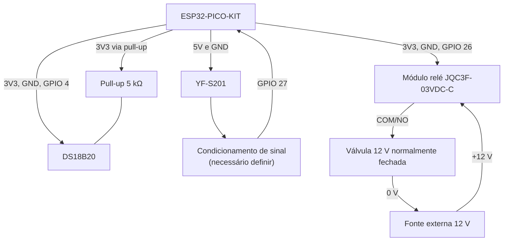

# Diagrama de ligação — camada de percepção

**Status:** preliminar, em validação. Este documento registra a topologia proposta; não substitui a conferência dos terminais e tensões antes da montagem.

## 1. Mapa de sinais

| Componente | Terminal | Destino |
|---|---|---|
| DS18B20 | Vermelho / VCC | 3V3 da ESP32-PICO-KIT |
| DS18B20 | Preto / GND | GND da ESP32-PICO-KIT |
| DS18B20 | Amarelo / DATA | GPIO 4 |
| DS18B20 | Resistor de 5 kΩ | Entre DATA e 3V3 |
| YF-S201 | Vermelho / VCC | 5V da ESP32-PICO-KIT (a validar por corrente disponível) |
| YF-S201 | Preto / GND | GND da ESP32-PICO-KIT |
| YF-S201 | Amarelo / SIGNAL | Circuito de condicionamento a definir e, depois, GPIO 27 |
| Módulo relé | DC+ | 3V3 da ESP32-PICO-KIT (topologia usada no teste anterior) |
| Módulo relé | DC- | GND da ESP32-PICO-KIT |
| Módulo relé | IN1 | GPIO 26 |
| Relé | COM | +12 V da fonte externa |
| Relé | NO | Positivo da válvula |
| Relé | NC | Não utilizado |
| Válvula | Negativo | Negativo da fonte externa de 12 V |

## 2. Diagrama funcional

## 3. Acionamento da válvula

Topologia de potência proposta:

1. Positivo da fonte de 12 V no contato COM.
2. Contato NO no positivo da válvula.
3. Negativo da válvula no negativo da fonte.
4. Contato NC sem utilização.

Quando o relé está desenergizado, COM-NO permanece aberto. A válvula normalmente fechada permanece sem alimentação.

A polaridade de acionamento de IN1 ainda é desconhecida. O firmware mantém a saída física desabilitada até essa informação ser confirmada.

## 4. Alimentação acordada para o protótipo

- ESP32-PICO-KIT: USB.
- DS18B20: 3,3 V da placa.
- YF-S201: 5 V da placa.
- Módulo relé: 3,3 V da placa.
- Válvula: fonte externa de 12 V.

A disponibilidade de corrente nas saídas 3,3 V e 5 V deve ser conferida com os consumos reais dos módulos. Não assumir que o regulador da placa suporta qualquer carga externa.

## 5. Proteções e cuidados

- Não conectar diretamente ao GPIO um sinal do YF-S201 que possa atingir 5 V. Confirmar se a saída é coletor aberto ou push-pull e dimensionar a interface.
- O resistor de 5 kΩ do DS18B20 fica entre DATA e 3,3 V.
- A implementação atual não utilizará diodo flyback externo, conforme decisão do projeto. Sem supressão, há risco de transiente na bobina ao desligar a válvula; monitorar interferência, resets e desgaste dos contatos.
- Confirmar corrente da válvula, corrente do relé, capacidade da fonte de 12 V e capacidade das saídas da placa.
- Não energizar a válvula enquanto a pinagem, a fonte e os contatos não tiverem sido conferidos.

## 6. Itens em validação

- Revisão física da ESP32-PICO-KIT e disponibilidade dos GPIOs 4, 27 e 26.
- Tipo de saída do YF-S201 e circuito de condicionamento.
- Corrente disponível na saída de 5 V da placa.
- Corrente consumida pelo módulo relé em 3,3 V e polaridade de IN1.
- Corrente nominal da válvula e especificação da fonte de 12 V.
